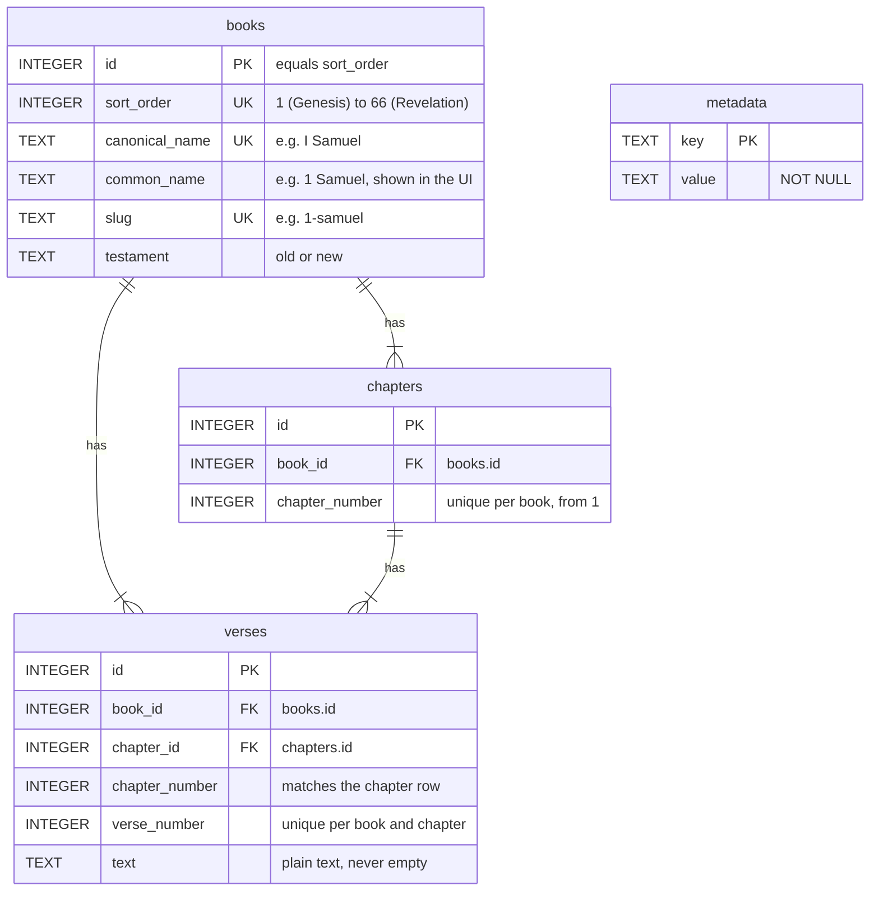

# Database schema

Every database this tool writes is a single SQLite file with the schema below. It is the format the
[bible-tui](https://github.com/codysechelski/bible-tui) app reads: a SQLite file that follows this schema opens in
bible-tui, whether this converter wrote it, another script did, or you or a coding agent built it by hand.
Copy it into `~/.config/bible-tui/bibles/` (or any folder bible-tui is told to search) and it appears in the
version picker. bible-tui's own description of the format is
[docs/bible-databases.md](https://github.com/codysechelski/bible-tui/blob/main/docs/bible-databases.md) in that
repository.

The schema is fixed. The converter's copy is `SCHEMA` in `bibles/writer.py`, and the tests check that it matches the
reference database's schema exactly.

## Entity relationship diagram



`metadata` stands alone: one key and value per row, describing the whole database. Every book has at least
one chapter and every chapter at least one verse. Each verse points to its book directly and to its chapter,
and deleting a book or chapter deletes its rows.

## SQL

```sql
CREATE TABLE metadata (
    key TEXT PRIMARY KEY,
    value TEXT NOT NULL
);

CREATE TABLE books (
    id INTEGER PRIMARY KEY,                -- equals sort_order
    sort_order INTEGER NOT NULL UNIQUE,    -- canonical position, 1 (Genesis) to 66 (Revelation)
    canonical_name TEXT NOT NULL UNIQUE,   -- e.g. "I Samuel"
    common_name TEXT NOT NULL,             -- shown in the UI, e.g. "1 Samuel"
    slug TEXT NOT NULL UNIQUE,             -- e.g. "1-samuel"
    testament TEXT NOT NULL CHECK (testament IN ('old', 'new'))
);

CREATE TABLE chapters (
    id INTEGER PRIMARY KEY,
    book_id INTEGER NOT NULL REFERENCES books(id) ON DELETE CASCADE,
    chapter_number INTEGER NOT NULL,       -- 1, 2, 3, ... with no gaps
    UNIQUE (book_id, chapter_number)
);

CREATE TABLE verses (
    id INTEGER PRIMARY KEY,
    book_id INTEGER NOT NULL REFERENCES books(id) ON DELETE CASCADE,
    chapter_id INTEGER NOT NULL REFERENCES chapters(id) ON DELETE CASCADE,
    chapter_number INTEGER NOT NULL,       -- repeats chapters.chapter_number for direct lookups
    verse_number INTEGER NOT NULL,
    text TEXT NOT NULL,                    -- plain text, never empty
    UNIQUE (book_id, chapter_number, verse_number)
);

CREATE INDEX idx_books_testament_order ON books(testament, sort_order);
CREATE INDEX idx_chapters_book_number ON chapters(book_id, chapter_number);
CREATE INDEX idx_verses_book_chapter_verse ON verses(book_id, chapter_number, verse_number);
CREATE INDEX idx_verses_chapter_number ON verses(chapter_id, verse_number);
```

Each chapter belongs to a book, and each verse to a book and a chapter; deleting a book or chapter deletes its
rows. `verses.chapter_id` and `verses.chapter_number` must agree with the chapter row they point to.

## Metadata

One row per key. The converter writes all of these:

| Key | Value | Used by bible-tui |
| --- | --- | --- |
| `version` | The abbreviation, for example `KJV`: `--abbreviation`, or worked out from the source (see [version and abbreviation](usage.md#version-and-abbreviation)). | The abbreviation for picking a version on the command line, in `default_version` and in saved state. Without it, the file name is used, upper-cased, with a leading `bible_` removed. |
| `version_name` | The full name, for example `King James Version`: `--version-name`, or worked out from the source, otherwise `version`. | Shown in the title bar, status bar and version picker. Falls back to the abbreviation. |
| `source` | Source file, folder or zip name and format, for example `kjv.usfm (usfm)`. | No |
| `created_at_utc` | When the database was written, ISO 8601 in UTC, for example `2026-10-22T14:30:05+00:00`. | No |
| `book_count`, `chapter_count`, `verse_count` | The number of rows written. | No |

## Rules

- **Text.** `verses.text` is plain text: no markup, footnotes, headings or cross references, with whitespace
  collapsed to single spaces. How the converter gets there is in [normalization](normalization.md).
- **Missing verses are left out**, not stored as empty text. A translation that omits Acts 8:37 simply has no row for it.
- **Book ids and order.** `books.id` equals `sort_order`, and `sort_order` is the canonical position below even
  for a Bible with only some books. bible-tui uses it to keep your place when you switch versions.
- **Chapters** are numbered from 1 with no gaps, and every chapter has at least one verse.
- **Book names.** `canonical_name` and `slug` are always the English values below, so they identify a book in
  any language. `common_name` is the name bible-tui shows: the English one below for an English Bible, and the
  translation's own (`Gênesis`, `Mateus`) for a Bible in another language. See
  [book names](normalization.md#6-book-names).

bible-tui reads `books(id, sort_order, common_name, testament)`, `chapters(book_id, chapter_number)`,
`verses(book_id, chapter_number, verse_number, text)` and the two metadata keys above. It allows extra tables,
columns and indexes, opens the file read-only, and skips a database with no verses. Following the full schema is
still the safe choice.

## Checking a database you built

`--validate` runs the converter's checks on any SQLite file, however it was made:

```sh
tool/bin/bibles --validate path/to/my-bible.sqlite                   # a whole Bible, 66 books
tool/bin/bibles --validate path/to/my-new-testament.sqlite --allow-partial
```

These checks are stricter than bible-tui (all seven metadata keys, English canonical names and slugs, the 66-book count); the
full list is in [validation](validation.md). A database that passes them works in bible-tui.

A quick query to check a database by hand:

```sql
SELECT b.common_name, v.chapter_number, v.verse_number, v.text
FROM verses v JOIN books b ON b.id = v.book_id
WHERE b.slug = 'john' AND v.chapter_number = 3 AND v.verse_number = 16;
```

## The 66 books

The values the converter writes to `books`, from `bibles/books.py`; a Bible in another language has its own
`common_name`. Chapters is the usual chapter count;
versification traditions differ, so a different count only warns.

| `sort_order` / `id` | `canonical_name` | `common_name` | `slug` | `testament` | Chapters |
| --- | --- | --- | --- | --- | --- |
| 1 | Genesis | Genesis | `genesis` | `old` | 50 |
| 2 | Exodus | Exodus | `exodus` | `old` | 40 |
| 3 | Leviticus | Leviticus | `leviticus` | `old` | 27 |
| 4 | Numbers | Numbers | `numbers` | `old` | 36 |
| 5 | Deuteronomy | Deuteronomy | `deuteronomy` | `old` | 34 |
| 6 | Joshua | Joshua | `joshua` | `old` | 24 |
| 7 | Judges | Judges | `judges` | `old` | 21 |
| 8 | Ruth | Ruth | `ruth` | `old` | 4 |
| 9 | I Samuel | 1 Samuel | `1-samuel` | `old` | 31 |
| 10 | II Samuel | 2 Samuel | `2-samuel` | `old` | 24 |
| 11 | I Kings | 1 Kings | `1-kings` | `old` | 22 |
| 12 | II Kings | 2 Kings | `2-kings` | `old` | 25 |
| 13 | I Chronicles | 1 Chronicles | `1-chronicles` | `old` | 29 |
| 14 | II Chronicles | 2 Chronicles | `2-chronicles` | `old` | 36 |
| 15 | Ezra | Ezra | `ezra` | `old` | 10 |
| 16 | Nehemiah | Nehemiah | `nehemiah` | `old` | 13 |
| 17 | Esther | Esther | `esther` | `old` | 10 |
| 18 | Job | Job | `job` | `old` | 42 |
| 19 | Psalms | Psalms | `psalms` | `old` | 150 |
| 20 | Proverbs | Proverbs | `proverbs` | `old` | 31 |
| 21 | Ecclesiastes | Ecclesiastes | `ecclesiastes` | `old` | 12 |
| 22 | Song of Solomon | Song of Solomon | `song-of-solomon` | `old` | 8 |
| 23 | Isaiah | Isaiah | `isaiah` | `old` | 66 |
| 24 | Jeremiah | Jeremiah | `jeremiah` | `old` | 52 |
| 25 | Lamentations | Lamentations | `lamentations` | `old` | 5 |
| 26 | Ezekiel | Ezekiel | `ezekiel` | `old` | 48 |
| 27 | Daniel | Daniel | `daniel` | `old` | 12 |
| 28 | Hosea | Hosea | `hosea` | `old` | 14 |
| 29 | Joel | Joel | `joel` | `old` | 3 |
| 30 | Amos | Amos | `amos` | `old` | 9 |
| 31 | Obadiah | Obadiah | `obadiah` | `old` | 1 |
| 32 | Jonah | Jonah | `jonah` | `old` | 4 |
| 33 | Micah | Micah | `micah` | `old` | 7 |
| 34 | Nahum | Nahum | `nahum` | `old` | 3 |
| 35 | Habakkuk | Habakkuk | `habakkuk` | `old` | 3 |
| 36 | Zephaniah | Zephaniah | `zephaniah` | `old` | 3 |
| 37 | Haggai | Haggai | `haggai` | `old` | 2 |
| 38 | Zechariah | Zechariah | `zechariah` | `old` | 14 |
| 39 | Malachi | Malachi | `malachi` | `old` | 4 |
| 40 | Matthew | Matthew | `matthew` | `new` | 28 |
| 41 | Mark | Mark | `mark` | `new` | 16 |
| 42 | Luke | Luke | `luke` | `new` | 24 |
| 43 | John | John | `john` | `new` | 21 |
| 44 | Acts | Acts | `acts` | `new` | 28 |
| 45 | Romans | Romans | `romans` | `new` | 16 |
| 46 | I Corinthians | 1 Corinthians | `1-corinthians` | `new` | 16 |
| 47 | II Corinthians | 2 Corinthians | `2-corinthians` | `new` | 13 |
| 48 | Galatians | Galatians | `galatians` | `new` | 6 |
| 49 | Ephesians | Ephesians | `ephesians` | `new` | 6 |
| 50 | Philippians | Philippians | `philippians` | `new` | 4 |
| 51 | Colossians | Colossians | `colossians` | `new` | 4 |
| 52 | I Thessalonians | 1 Thessalonians | `1-thessalonians` | `new` | 5 |
| 53 | II Thessalonians | 2 Thessalonians | `2-thessalonians` | `new` | 3 |
| 54 | I Timothy | 1 Timothy | `1-timothy` | `new` | 6 |
| 55 | II Timothy | 2 Timothy | `2-timothy` | `new` | 4 |
| 56 | Titus | Titus | `titus` | `new` | 3 |
| 57 | Philemon | Philemon | `philemon` | `new` | 1 |
| 58 | Hebrews | Hebrews | `hebrews` | `new` | 13 |
| 59 | James | James | `james` | `new` | 5 |
| 60 | I Peter | 1 Peter | `1-peter` | `new` | 5 |
| 61 | II Peter | 2 Peter | `2-peter` | `new` | 3 |
| 62 | I John | 1 John | `1-john` | `new` | 5 |
| 63 | II John | 2 John | `2-john` | `new` | 1 |
| 64 | III John | 3 John | `3-john` | `new` | 1 |
| 65 | Jude | Jude | `jude` | `new` | 1 |
| 66 | Revelation of John | Revelation | `revelation` | `new` | 22 |
